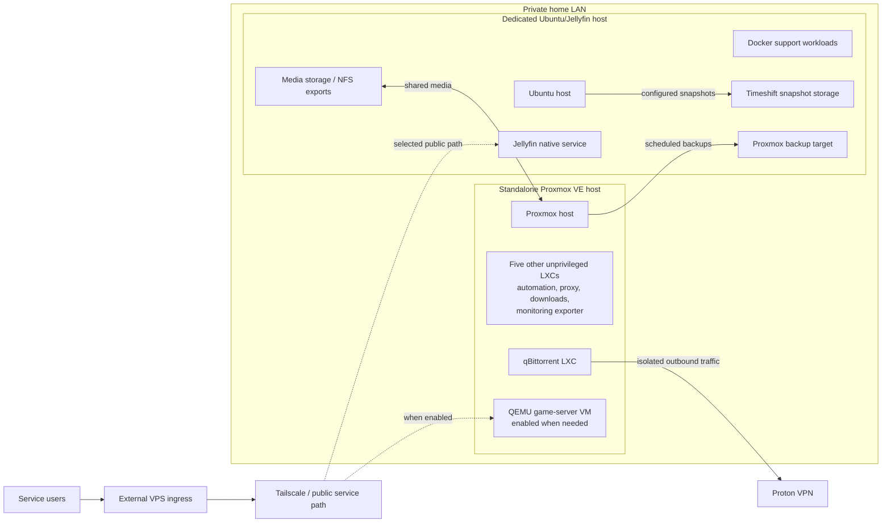
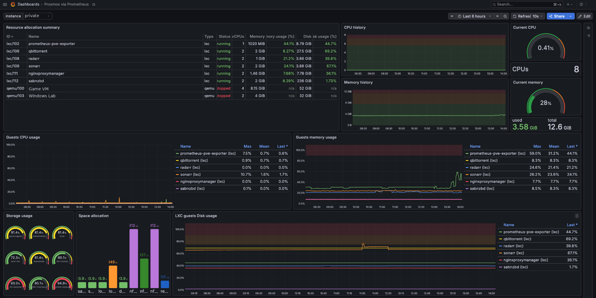
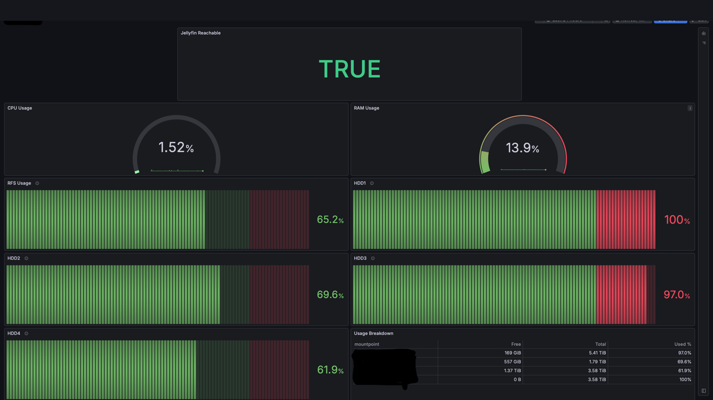

# Self-Hosted Infrastructure | Systems Administration Portfolio

**Linux · Proxmox VE · Networking · Virtualization · Monitoring · Disaster Recovery**

I independently operate and maintain a two-host Linux environment delivering media, automation, monitoring, and game services used by **20+ people over time**. This repository documents the systems behind those services, the operational decisions I have made, and how I investigate and recover from real failures.

## At a glance

| Area | Environment and responsibility |
| --- | --- |
| Infrastructure | Two physical Linux hosts: a standalone Proxmox VE server and a dedicated Ubuntu/Jellyfin server |
| Virtualization | Six unprivileged LXC workloads and an on-demand QEMU game-server VM |
| Networking | Private LAN, cross-host NFS storage, Tailscale overlay access, external VPS ingress, and workload-specific VPN egress |
| Monitoring | Prometheus, Grafana, Proxmox exporter, and Node Exporter |
| Operations | Service troubleshooting, system recovery, backup configuration, dependency management, and technical documentation |

## Selected engineering outcomes

- **Recovered core services after a Linux root-filesystem failure in approximately two hours.** Restored the Ubuntu host from a Timeshift snapshot, recovered additional configuration manually, and verified application and cross-host NFS functionality. [Read the recovery incident report](operations/incidents/2026-01-jellyfin-root-filesystem-recovery.md).
- **Resolved a Proxmox startup-blocking NFS dependency.** Diagnosed a failure after a power outage, changed host mount behavior to allow degraded startup, and validated the remediation by deliberately bringing down the NFS host. [Read the NFS incident report](operations/incidents/2026-07-proxmox-nfs-startup-dependency.md).
- **Successfully restored a game-server VM from backup during a controlled recovery test.** See the [backup strategy](operations/backups.md) and [disaster recovery](operations/disaster-recovery.md) documentation.

## Architecture

- **Proxmox VE host:** Runs six unprivileged LXC workloads for infrastructure and media automation, alongside a QEMU game-server VM enabled when needed.
- **Ubuntu/Jellyfin host:** Runs Jellyfin natively, supporting Docker applications, NFS media exports, and backup/snapshot storage.
- **Remote connectivity:** Selected public services use an external VPS and Tailscale. Other internal services have no intentionally published inbound path.
- **Shared storage:** The Ubuntu host serves media over NFS to Proxmox, centralizing media storage on the dedicated server.

*Public ingress and reverse-proxy routing are shown at a high level to protect internal configuration details.* See the [network architecture](architecture/network.md) and [service placement](architecture/services.md) documents for additional technical detail.

## Technologies and operational work

| Focus | Technologies and work |
| --- | --- |
| Linux and virtualization | Debian, Ubuntu Server, Proxmox VE, LXC, QEMU, LVM-thin; host and guest administration |
| Networking and access | Tailscale, VPN routing, NFS, DNS, reverse proxying, and troubleshooting cross-host connectivity |
| Applications | Jellyfin, Docker, Sonarr, Radarr, qBittorrent, SABnzbd, Seerr, Prowlarr, Bazarr, and game services |
| Observability | Prometheus, Grafana, Prometheus PVE Exporter, Node Exporter, and operational log analysis |
| Resilience | Timeshift snapshots, scheduled Proxmox backups, incident investigation, controlled recovery tests, and dependency remediation |

## Infrastructure monitoring

Prometheus, Grafana, Node Exporter, and the Proxmox exporter are used to observe host availability, resource utilization, storage capacity, and virtualized workload behavior.

### Proxmox and virtualized workloads

*LXC and QEMU workload monitoring, including CPU, memory, and storage utilization.*

### Jellyfin host

## Explore the documentation

| Area | Documents |
| --- | --- |
| Architecture | [Overview](architecture/overview.md) · [Network](architecture/network.md) · [Service placement](architecture/services.md) |
| Systems | [Proxmox host](systems/proxmox.md) · [Jellyfin host](systems/jellyfin-server.md) |
| Operations | [Monitoring](monitoring/overview.md) · [Backup strategy](operations/backups.md) · [Disaster recovery](operations/disaster-recovery.md) |
| Incident reports | [Linux filesystem recovery](operations/incidents/2026-01-jellyfin-root-filesystem-recovery.md) · [Proxmox/NFS startup dependency](operations/incidents/2026-07-proxmox-nfs-startup-dependency.md) |

*I keep credentials, exact addresses, internal service endpoints, and sensitive configuration private. Where I haven't checked a detail or tested a behavior, I say so rather than present an assumption as fact.*
