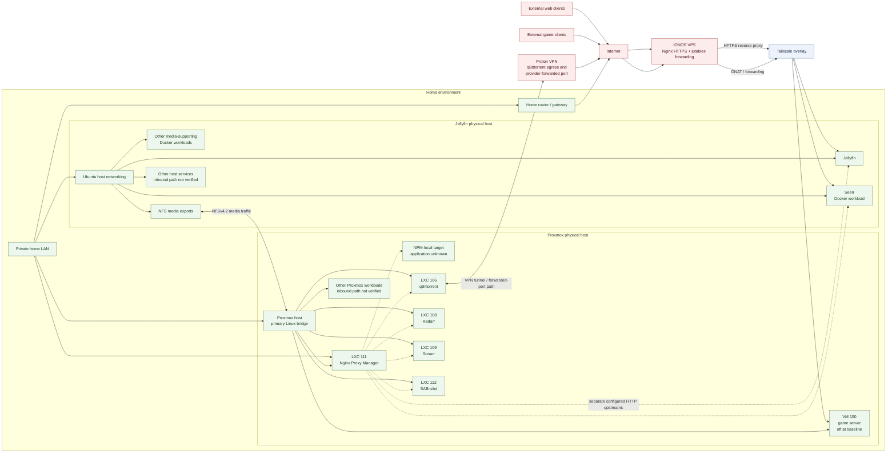

# Network Architecture

**Baseline verified:** 2026-10-01

## Scope

This document describes high-level connectivity without publishing exact addresses, domains, tunnel configuration, firewall rules, credentials, or provider-assigned ports. Detailed firewall and tailnet access-control policy are intentionally omitted.

## Connectivity model

Nginx Proxy Manager (NPM) is in LXC 111 and provides a separate reverse-proxy configuration for Jellyfin, Seerr, qBittorrent, Radarr, Sonarr, SABnzbd, and one NPM-local loopback target whose application identity is unconfirmed. All seven configured upstreams use HTTP. This is not the VPS ingress path: VPS Nginx proxies Jellyfin and Seerr directly over Tailscale, while VPS iptables forwards game traffic to the game-server VM. The NPM routes are configured separately for LAN or other authorized private clients; their external reachability is not established.

## Home LAN

Both physical hosts use wired interfaces on the same private `/24` LAN. The Proxmox uplink feeds a primary Linux bridge, with each active LXC connected through a virtual Ethernet interface. The Jellyfin host connects directly to the LAN and also exposes Docker bridge networks internally to that host.

Both hosts have Wi-Fi hardware, but their wireless interfaces were down at baseline. No VLAN topology is documented. The home router provides the default LAN path; its configuration, filtering policy, and DNS behavior are outside the documented scope.

### Internal service reachability

Jellyfin and Seerr are the web services intentionally published through the IONOS VPS; game traffic has a separate configured forwarding path to the on-demand game-server VM. qBittorrent, Radarr, Sonarr, and SABnzbd administrative interfaces are intended to remain private. Limited unauthenticated reachability checks did not establish public access to these interfaces, but this does not prove that every alternate network path is blocked.

NPM labels all seven proxy hosts “Publicly Accessible,” meaning no NPM access list is assigned. This is an NPM access-control setting, not proof of Internet reachability; if a request reaches one of these hosts through NPM, NPM applies no access-list restriction. Home-edge firewall/NAT reachability is not established. Detailed firewall and tailnet peer-authorization policy is intentionally omitted from this public document.

The NPM administration interface was observed on the private LAN, and no NPM administration proxy host was present in its seven-host list. Its reachability through other network paths is not fully established.

## Tailscale and public ingress

Tailscale connects the IONOS VPS and home hosts, carrying the confirmed web and game-server ingress paths. The security design keeps public service forwarding on the VPS and its Tailscale connections rather than publishing the home LAN directly. Detailed tailnet authorization and VPS filtering configuration are intentionally omitted.

Jellyfin and Seerr are the web services confirmed as intentionally public-facing. Public clients reach Nginx on the IONOS VPS over HTTPS; Nginx forwards requests directly over Tailscale to the Ubuntu media host, bypassing NPM. The VPS also forwards configured Minecraft and Project Zomboid game traffic with iptables DNAT over Tailscale to the on-demand game-server VM. These forwarding rules do not establish that guest applications are currently running or reachable. The VPS advertises no subnet routes and is not an exit node.

During a historical 12-hour IONOS outage, about 10 of the environment's 20+ users temporarily retained Jellyfin access through a restricted, sanitized Tailscale path that did not depend on the unavailable normal VPS route. Their access returned promptly after they enabled the VPN; users without tailnet access remained affected until the normal path recovered. Exact peer policy and access details are intentionally omitted.

This design avoids relying on direct publication of the broader home LAN. Exact domains, public addresses, tunnel addresses, VPS listener configuration, and cryptographic material are intentionally omitted.

NPM has seven configured HTTP-upstream proxy hosts: Jellyfin, Seerr, qBittorrent, Radarr, Sonarr, SABnzbd, and one unresolved NPM-local target. NPM is separate from the confirmed VPS ingress path. Its certificate configuration covers Jellyfin, Seerr, and SABnzbd: HTTPS redirection and HTTP/2 are enabled for Jellyfin and Seerr; SABnzbd has a certificate assigned without forced HTTPS redirection. HSTS is disabled on these certificate-backed hosts. These NPM settings describe the separate proxy hosts and do not establish their Internet reachability.

## qBittorrent and Proton VPN

qBittorrent runs in unprivileged LXC 106. Its external connectivity has two deliberate properties:

- outbound qBittorrent traffic uses Proton VPN rather than the normal LAN egress path;
- qBittorrent is bound to the port forwarded by Proton VPN.

qBittorrent fails closed when the VPN path drops; it does not fall back to normal LAN egress. This behavior has been tested. VPN endpoints, addresses, credentials, protocol configuration, firewall rules, and forwarded port numbers are intentionally omitted.

## NFS storage traffic

The Jellyfin host provides three NFSv4.2 media exports consumed by the Proxmox host. The Proxmox client mounts are read-write and use one internal source. This relationship is LAN-local and supports shared media access between the storage host and Proxmox-hosted workloads.

The exact export definitions, per-client permissions, and mapping of individual exports to LXC guests were not accessible. Architecture diagrams therefore show the relationship at host/bridge level rather than claiming direct mounts inside specific containers.

A storm-related power outage caused Proxmox to start before the Jellyfin/NFS host. All three mounts entered a persistent blocking state that affected the Proxmox web interface and media-management workloads. The host mount configuration was changed afterward to use `nofail` with a reduced timeout so unavailable NFS shares produce degraded behavior rather than blocking startup.

The remediation was tested by powering off the Jellyfin host. Proxmox and its LXCs started normally while media functions remained degraded until NFS returned. Automatic restart behavior and Wake-on-LAN procedures were also enabled for the Jellyfin host. NFS availability is now monitored through Prometheus and Grafana, although exact scrape and alert configuration has not been documented.

## Host-local container networking

The Jellyfin host had three active Docker bridges, three virtual Ethernet interfaces, and three Docker network namespaces supporting Seerr, Bazarr, and Prowlarr. Seerr's published listener was mapped directly; exact process-to-container mappings for Bazarr and Prowlarr remain unavailable. Container network names, address ranges, and detailed publication rules remain undocumented.

On Proxmox, six LXC virtual Ethernet interfaces were attached to the primary bridge. Docker/containerd processes were also visible inside the LXC process tree, indicating nested container activity, but the responsible guest and network design were not confirmed.

## Traffic and exposure summary

| Source | Destination | Purpose | Exposure note |
|---|---|---|---|
| Public web clients | IONOS VPS / Nginx, then Jellyfin and Seerr over Tailscale | Media access | Intentionally public; NPM is not in this path |
| Proxmox host | Jellyfin host | Three NFSv4.2 media mounts | Private LAN relationship |
| qBittorrent LXC | Proton VPN / Internet | Isolated application egress | Provider-forwarded port; details omitted |
| LAN clients | Internal applications and management services | Local service use and administration | Intended private; public reachability is not fully verified |
| Public game clients | IONOS VPS / iptables forwarding, then game-server VM over Tailscale | Minecraft and Project Zomboid traffic | Forwarding is configured; VM services are on demand and end-to-end availability is not implied |
| LAN or authorized private clients | Nginx Proxy Manager, then configured HTTP upstreams | Separate application reverse proxy | No NPM access lists are assigned; this does not establish Internet reachability |
| VPS and home hosts | Tailscale overlay | Encrypted connectivity for public service ingress | The VPS advertises no subnet routes and is not configured as an exit node; detailed peer-authorization policy is intentionally omitted |
| Approximately 10 trusted users | Restricted Tailscale path to Jellyfin | Temporary access during a 12-hour normal VPS-path outage | Access returned promptly after VPN activation; exact peers and policy omitted |
| Proxmox host | Jellyfin backup partition | Scheduled Proxmox backups | Internal storage path; filesystem path omitted here |

## Security boundaries and private details

The documentation distinguishes known private-LAN traffic, Tailscale-based public paths, and qBittorrent's Proton VPN egress path. It does not establish:

- exact firewall or NAT rules;
- detailed Tailscale peer-authorization rules, which are intentionally omitted from this public document;
- detailed VPS Nginx TLS and forwarded-client-IP directives;
- DNS provider or record design;
- Docker publication policy beyond the current listeners;
- VLANs or other LAN segmentation;
- Detailed VPN implementation and qBittorrent's fail-closed configuration.

I keep exact firewall, DNS, Tailscale, VPN, and VPS settings private. The documented public web and game paths use the VPS and Tailscale; NPM provides a separate application-proxy configuration.
