# Service Placement

**Baseline verified:** 2026-10-01

This document maps known workloads to physical hosts and execution layers—native host services, LXC containers, QEMU VMs, and Docker workloads. I call out placements that I haven't mapped rather than infer them.

## Placement diagram

```mermaid
flowchart TB
    WEB_CLIENTS["External web clients"]
    GAME_CLIENTS["External game clients"]
    PRIVATE_CLIENTS["LAN / authorized private clients"]
    VPS["IONOS VPS<br/>Nginx HTTPS / iptables DNAT"]
    TS_OVERLAY["Tailscale overlay"]

    subgraph PHYSICAL["Physical infrastructure"]
        subgraph PVE["Getorli GT100 — Proxmox VE host"]
            PVECORE["Proxmox VE host layer"]

            subgraph LXC["Unprivileged LXC layer"]
                C102["LXC 102<br/>Prometheus PVE Exporter"]
                C106["LXC 106<br/>qBittorrent"]
                C108["LXC 108<br/>Radarr"]
                C109["LXC 109<br/>Sonarr"]
                C111["LXC 111<br/>Nginx Proxy Manager"]
                NPMLOCAL["NPM-local target<br/>application unknown"]
                C112["LXC 112<br/>SABnzbd"]
                MON["Prometheus / Grafana processes<br/>exact guest not yet mapped"]
                NESTED["Nested Docker/containerd<br/>exact guest not yet mapped"]
            end

            subgraph QEMU["QEMU VM layer"]
                V100["VM 100 — game server<br/>Minecraft / Project Zomboid history<br/>off at baseline"]
                V103["VM 103 — Windows Server lab<br/>inactive / historical"]
            end
        end

        subgraph JHOST["ASUS GL702VM — Jellyfin host"]
            subgraph NATIVE["Native host layer"]
                JELLY["Jellyfin"]
                NFS["NFS server"]
                NODE["Prometheus Node Exporter"]
                TS["Timeshift"]
                JBACKUP["Dedicated Proxmox<br/>backup partition"]
            end

            subgraph DENGINE["Docker Engine"]
                SEERR["Seerr<br/>Docker workload"]
                PROWLARR["Prowlarr<br/>metadata unavailable"]
                BAZARR["Bazarr<br/>metadata unavailable"]
            end
        end
    end

    WEB_CLIENTS --> VPS
    GAME_CLIENTS --> VPS
    PRIVATE_CLIENTS --> C111
    VPS -->|"HTTPS reverse proxy"| TS_OVERLAY
    VPS -->|"configured game forwarding"| TS_OVERLAY
    TS_OVERLAY --> JELLY
    TS_OVERLAY --> SEERR
    TS_OVERLAY -->|"VM is on demand"| V100

    C106 -->|"Proton VPN egress"| VPN
    C111 -.->|"separate configured HTTP upstreams"| JELLY
    C111 -.-> SEERR
    C111 -.-> C106
    C111 -.-> C108
    C111 -.-> C109
    C111 -.-> C112
    C111 -.-> NPMLOCAL
    NFS <-->|"Host-level NFS mount relationship"| PVECORE
    PVECORE -->|"Scheduled Proxmox backup job"| JBACKUP

    classDef physical fill:#eef7ee,stroke:#4f7d53,stroke-width:2px,color:#173a1a;
    classDef container fill:#eef3fb,stroke:#4777a8,color:#102a43;
    classDef vm fill:#f3edfb,stroke:#7653a6,color:#2f174e;
    classDef native fill:#fff7e6,stroke:#a87520,color:#4a3200;
    classDef not_yet_mapped fill:#f4f4f5,stroke:#71717a,color:#3f3f46,stroke-dasharray:5 4;
    classDef external fill:#fdecec,stroke:#a94442,color:#4a1515;
    classDef overlay fill:#eef3fb,stroke:#4777a8,color:#102a43;

    class C102,C106,C108,C109,C111,C112,SEERR container;
    class V100,V103 vm;
    class PVECORE,JELLY,NFS,NODE,TS,JBACKUP native;
    class MON,NESTED,PROWLARR,BAZARR not_yet_mapped;
    class WEB_CLIENTS,GAME_CLIENTS,PRIVATE_CLIENTS,VPS,VPN external;
    class TS_OVERLAY overlay;
```

Prowlarr and Bazarr run through Docker, but detailed container metadata and exact process-to-container mappings are unavailable. Prometheus, Grafana, and nested Docker/containerd run within the Proxmox LXC layer; no specific LXC assignment is made.

## Proxmox physical host

The Getorli GT100 runs Proxmox VE as a standalone virtualization host. Six active, unprivileged LXCs provide the service workloads documented below.

### LXC workloads

| Guest | Workload | Layer | Baseline state | Architectural role |
|---|---|---|---|---|
| 102 | Prometheus PVE Exporter | Unprivileged LXC | Running | Exposes Proxmox telemetry to the monitoring system. |
| 106 | qBittorrent | Unprivileged LXC | Running | Uses Proton VPN and its forwarded port; tested to fail closed when the VPN path drops. Its administrative interface is intended to remain private. |
| 108 | Radarr | Unprivileged LXC | Running | Media-automation workload; its administrative interface is intended to remain private. |
| 109 | Sonarr | Unprivileged LXC | Running | Media-automation workload; its administrative interface is intended to remain private. |
| 111 | Nginx Proxy Manager | Unprivileged LXC | Running | Separate reverse proxy for seven configured application web interfaces; all upstreams use HTTP. It is not in the confirmed VPS public web or game-server ingress paths. |
| 112 | SABnzbd | Unprivileged LXC | Running | Download-automation workload; its administrative interface is intended to remain private. |

The Jellyfin host provides three media NFS exports to Proxmox, but per-guest mount assignments were inaccessible. Several LXC applications participate in media workflows, but this document does not claim that each guest directly mounts every export.

### Proxmox-hosted processes not yet mapped to guests

Prometheus, Grafana, `pve_exporter`, Docker/containerd, Nginx, Node.js, and Python processes appear in LXC workloads, but I haven't tied each process to a specific guest. Consequently:

- LXC 102 is documented with its Prometheus PVE Exporter role; Prometheus and Grafana are not assigned to it without additional placement data.
- nested Docker is documented as present somewhere in the LXC layer, not as a property of a named guest;
- generic Nginx, Node.js, and Python processes are not treated as additional independently placed services.

### QEMU virtual machines

| Guest | Workload | Layer | State/scope | Architectural role |
|---|---|---|---|---|
| 100 | Game server | QEMU VM | Powered off at baseline; only VM currently in use | Has hosted Minecraft and Project Zomboid. Current in-guest application configuration is not documented. |
| 103 | Windows Server lab | QEMU VM | Inactive; not used recently | Historical lab for domain-controller and other Windows Server testing. It is outside the current service scope and does not represent active Active Directory. |

The documentation includes VM 100 and VM 103. Proxmox ACL restrictions prevented a complete guest enumeration, so it does not assert that these are the only configured VMs.

## Jellyfin physical host

The ASUS GL702VM combines native media-serving and storage services with a small Docker application layer.

### Native host services

| Service | Layer | Architectural role |
|---|---|---|
| Jellyfin | Native systemd service | Primary media-serving application and one of two services intentionally exposed through IONOS VPS Nginx over Tailscale. VPS Nginx reaches Jellyfin directly rather than through NPM. |
| NFS server | Native host service | Supplies three media-storage mounts to the Proxmox host. Exact export definitions are intentionally not documented. |
| Prometheus Node Exporter | Native systemd service | Provides host telemetry. Scrape target configuration and alert relationships are not documented. |
| Tailscale | Native host service | Connects the host to the overlay used by the IONOS VPS public ingress path. |
| Docker Engine / containerd | Native runtime | Runs three container workloads, network namespaces, and related bridges. Detailed container metadata is unavailable. |
| Timeshift | RSYNC-mode system snapshot mechanism | Configured for daily snapshots with retention of seven on a dedicated, separately mounted approximately 125 GB SSD. Large media filesystems and the replaceable downloads directory are excluded. A manual snapshot reported approximately 52 GB; historical OS and Jellyfin configuration/user-file restoration succeeded. |

Jellyfin runs directly on the host rather than through Docker and uses the NVIDIA GTX 1060 for hardware transcoding. Parallel transcodes are uncapped. Public web requests arrive through Nginx on the IONOS VPS and travel over Tailscale directly to Jellyfin; Nginx Proxy Manager is not in this path.

### Docker workloads

| Workload | Layer | Architectural role |
|---|---|---|
| Seerr | Docker workload | Media-request aggregator used by the service user community and the second service intentionally exposed through IONOS VPS Nginx over Tailscale. VPS Nginx reaches Seerr directly; NPM is not in this path. |
| Prowlarr | Docker workload; detailed metadata unavailable | Media indexer-management application. |
| Bazarr | Docker workload; detailed metadata unavailable | Subtitle-management application. |

Three container shims, Docker bridges, veth interfaces, and network namespaces support these applications. Seerr's published listener was mapped directly; exact process-to-container mappings for Prowlarr and Bazarr remain unavailable. Container images, versions, health checks, volume mappings, and network names have not been documented.

## Shared and external services

| Component | Placement | Relationship |
|---|---|---|
| IONOS VPS | External hosted system | Nginx terminates public HTTPS and proxies Jellyfin and Seerr directly over Tailscale. Separate iptables DNAT forwards configured game traffic over Tailscale to the on-demand game-server VM. The user reports hardening changes to the VPS tailnet role and IONOS ingress and administrative controls; these changes have not been independently verified in this repository. The VPS advertises no subnet routes and is not an exit node; detailed rules are omitted. |
| Proton VPN | External VPN provider | Carries qBittorrent external traffic and supplies its forwarded-port path. Configuration details are intentionally omitted. |
| Proxmox backup target | Dedicated partition on Jellyfin host | Target for a backup job scheduled at 04:00 local time each day; retention keeps the latest seven and four weekly backups. Public documentation omits the local mount path. |
| Media archive | Filesystems attached to Jellyfin host | Shared to Proxmox over NFS. It currently has no backup or replica because of budget constraints. |

## Service relationships

### Media request and automation

Seerr is the user-facing request aggregator. Radarr, Sonarr, Prowlarr, Bazarr, SABnzbd, qBittorrent, Jellyfin, and shared media storage form the broader media service set. Their placement is described above; API integrations, queue flows, credentials, and exact filesystem handoffs have not been documented.

Large media HDD filesystems are outside Timeshift scope, and the replaceable completed-downloads directory is explicitly excluded. The exact service-to-directory sequence, staging location, and mount mappings are not confirmed. Seerr, Bazarr, and Prowlarr configuration files were copied manually during recovery and are within current Timeshift scope, but their current presence was not independently inspected and the current Docker configuration has not been separately restore-tested.

### Monitoring

The known monitoring components are:

- Prometheus PVE Exporter in LXC 102;
- Prometheus and Grafana processes somewhere in the Proxmox-hosted LXC layer;
- Prometheus Node Exporter on the Jellyfin host.

The exporter, collector, and dashboard roles suggest a conventional telemetry flow. Exact scrape targets, ports, retention, dashboards, alerting, and the complete monitoring pipeline have not been documented.

### Reverse proxy and public services

Nginx Proxy Manager runs in LXC 111 as a reverse proxy separate from the VPS ingress path. It has seven configured application hosts: Jellyfin, Seerr, qBittorrent, Radarr, Sonarr, SABnzbd, and one NPM-local loopback target whose application identity is unconfirmed. Jellyfin and Seerr route to services on the Jellyfin host; qBittorrent, Radarr, Sonarr, and SABnzbd route to internal Proxmox guests. All seven upstreams use HTTP.

NPM has Let’s Encrypt certificates assigned to Jellyfin, Seerr, and SABnzbd. Force HTTPS and HTTP/2 are enabled for Jellyfin and Seerr. SABnzbd has a certificate assigned but does not force HTTPS redirection; HSTS is disabled on the certificate-backed hosts. These are NPM settings; VPS Nginx is a separate public HTTPS endpoint whose detailed TLS directives are not included here.

The confirmed public web path is Internet → IONOS VPS Nginx → Tailscale → Jellyfin or Seerr directly. Game traffic follows a separate VPS iptables DNAT/forwarding path over Tailscale to the on-demand game-server VM. NPM is not part of either confirmed ingress path. qBittorrent, Radarr, Sonarr, and SABnzbd administrative interfaces are intended to remain private; limited unauthenticated checks did not establish public access but cannot prove every alternate route is blocked.

NPM marks all seven hosts “Publicly Accessible,” meaning no NPM access list is assigned. This setting is not evidence of Internet reachability; if a request reaches one of these hosts through NPM, no NPM access-list restriction applies. The NPM administration UI was observed on the private LAN, and no administration proxy host appeared in the seven-host list. Detailed firewall and tailnet policy are intentionally omitted from this public documentation.

### Backup services

- Jellyfin host: Timeshift in RSYNC mode, configured for daily system snapshots with retention of seven on a dedicated approximately 125 GB SSD. Large media filesystems and the replaceable downloads directory are excluded. An initial manual snapshot created on 2026-10-01 reported approximately 52 GB.
- Proxmox: backup job configured for 04:00 local time each day to the dedicated Jellyfin-host partition, keeping the latest seven and four weekly backups.
- Media archive: no backup or replica at present; reacquisition is the accepted recovery approach for replaceable content.
- Portable SSD: currently contains media and is intended for future backup use, but that future role is not documented as a current capability.

Timeshift successfully restored the operating system and important Jellyfin configuration/user files during a historical root-filesystem recovery. Docker configuration was copied manually during that incident and is now within Timeshift scope, but has not been separately restore-tested. VM 100 was also successfully restored from Proxmox backup as a test. Isolated restore timing and broader recovery validation have not been documented.

## Placement limitations

I haven't mapped the following placements or relationships, and I keep sensitive configuration private:

- exact LXC placement of Prometheus, Grafana, and nested Docker;
- detailed Proxmox guest configuration beyond the documented mappings;
- current Minecraft and Project Zomboid installation/configuration inside powered-off VM 100;
- Prowlarr and Bazarr container metadata;
- per-guest NFS mount mapping;
- application versions, credentials, secrets, and detailed configuration.
