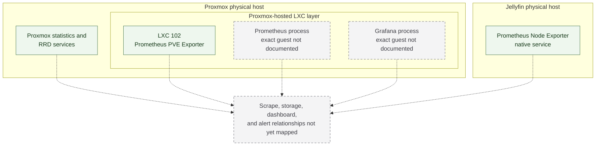

# Monitoring Overview

**Baseline date:** 2026-10-01

## Scope

The monitoring footprint includes Prometheus, Grafana, a Prometheus PVE Exporter workload, Proxmox host telemetry services, and Prometheus Node Exporter on the Jellyfin host. The complete Prometheus architecture is not yet mapped: exact scrape relationships, component versions, configuration, retention, dashboards, alert rules, and notification paths have not been documented.

## Known components

| Component | Known placement | What is known |
|---|---|---|
| Prometheus PVE Exporter | Unprivileged Proxmox LXC 102 | The guest was running at baseline and provides the identified Proxmox exporter workload. |
| `pve_exporter` process | Proxmox-hosted LXC process tree | I haven't tied the process to a guest beyond the LXC 102 exporter role. |
| Prometheus | Somewhere in the Proxmox-hosted LXC layer | Its guest, configuration, targets, and data path are not documented. |
| Grafana | Somewhere in the Proxmox-hosted LXC layer | Its guest, data source configuration, dashboards, and access path are not documented. |
| Proxmox statistics services | Proxmox physical host | Proxmox statistics and RRD-related services were active, including host statistics collection and RRD caching components. |
| Prometheus Node Exporter | Jellyfin physical host | Runs as an active system service; scrape configuration is not yet documented. |
| NFS availability coverage | Prometheus/Grafana relationship not yet mapped | Monitoring was added after a historical NFS startup-dependency incident. Exact metric source, dashboard, threshold, and notification behavior are not documented. |

## Placement model

The dashed edges do not represent scrape flows. They show that each component's relationship to the end-to-end monitoring design has not yet been mapped.

## Proxmox telemetry

The Proxmox host runs platform statistics services, RRD caching, and status daemons. LXC 102 provides the Prometheus PVE Exporter workload.

The platform-native telemetry and a Prometheus-compatible exporter are present. I haven't documented the following:

- which Proxmox API endpoint or account the exporter uses;
- what permissions or collection scope are configured;
- whether the exporter is currently scraped successfully;
- whether host, guest, storage, or cluster metrics are retained;
- whether any exporter errors or stale series exist.

The host is intentionally standalone; active Proxmox HA-related units do not provide cluster monitoring coverage.

## Jellyfin host telemetry

Prometheus Node Exporter runs directly on the Jellyfin physical host. This provides an operating-system telemetry endpoint, but the data path beyond it is not documented.

Node Exporter flags, enabled collectors, filtering, authentication, and scrape status are not documented. Application-level Jellyfin metrics are also not documented. Jellyfin uses the NVIDIA GTX 1060 for hardware transcoding, but no GPU exporter or GPU monitoring integration is documented.

External HDDs on this host hold media, and high utilization—including full filesystems—is expected and acceptable. No monitoring threshold or alert is documented to distinguish this normal archive state from unexpected system or staging-volume growth.

NFS availability is now monitored through Prometheus and Grafana after a historical outage. The metric source, scrape target, dashboard implementation, alert threshold, and notification delivery are not documented.

## Prometheus and Grafana

Prometheus and Grafana run within the Proxmox-hosted LXC layer, but their specific guest placement is not yet documented. LXC 102 is assigned to the PVE Exporter; I haven't mapped Prometheus or Grafana to a specific guest.

I haven't documented the following:

- whether Prometheus and Grafana share a guest;
- whether Grafana uses this Prometheus instance as a data source;
- whether either component is persistent, redundant, backed up, or externally accessible;
- whether dashboards cover both physical hosts or all workloads;
- whether alerting is configured.

## Coverage status

| Monitoring concern | Status |
|---|---|
| Component presence | Prometheus, Grafana, PVE Exporter, Proxmox telemetry services, and Jellyfin Node Exporter present |
| Exact component placement | PVE Exporter and Node Exporter mapped; Prometheus and Grafana not yet mapped |
| Scrape topology | Not documented |
| Target health | Current state not documented; NFS availability coverage is in place, but implementation details are not documented |
| Metric retention | Not documented |
| Dashboard inventory | Not documented |
| Alert rules and thresholds | Not documented |
| Notification delivery | Not documented |
| Monitoring authentication | Not inspected and intentionally not documented |
| Monitoring backup/recovery | Not documented |
| Availability or redundancy | Not documented |

Scrape health, dashboard rendering, alert delivery, and monitoring restoration have not been tested or documented.

## Operational considerations

- **Placement ambiguity:** troubleshooting Prometheus or Grafana requires first identifying the responsible LXC without assuming it is LXC 102.
- **Single-node context:** Proxmox telemetry describes a standalone host, not a multi-node cluster.
- **Capacity interpretation:** full external HDD media filesystems are expected and acceptable. Alerting, if configured, should distinguish that normal state from unexpected system or staging-volume growth; no such policy is documented.
- **Exporter presence versus coverage:** a running exporter demonstrates an endpoint, not successful collection or alerting.
- **NFS coverage:** NFS availability is monitored through Prometheus and Grafana, but alert-delivery and dashboard behavior are not documented.
- **Monitoring dependency chain:** a complete dependency graph cannot be documented until scrape targets, storage, dashboards, and notification paths are verified.

## Open questions

Material open questions are:

1. the LXC placement of Prometheus and Grafana;
2. Prometheus scrape targets and current target health;
3. Grafana data sources and dashboard inventory;
4. metric retention and storage location;
5. alert rules, thresholds, and notification paths;
6. monitoring access boundaries and availability expectations;
7. whether monitoring configuration or data is included in current backups.

These require further documentation before a conventional Prometheus deployment model can be described.
